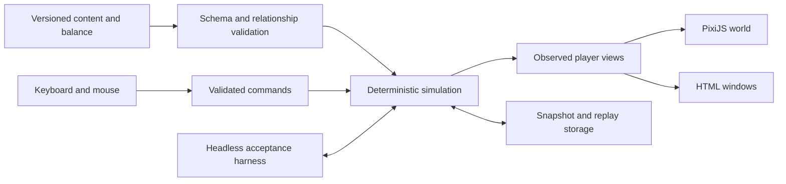

# Bunker implementation plan

Planning baseline: updated 12 November 2026. Source: [technical specification v1.0](spec/bunker_technical_spec_ru_v1.md), its [complete companion package](spec/README.md), and the [temperature decision 1.1](fungus-temperature-v1_1.md). The active implementation balance is [1.1](../data/bunker_balance_v1_1.json). Engineering kernel 0.2 and the developer interface are implemented and verified: 41 dependency-free checks, 34 Vitest checks, type checking/build, and all 3 Chromium scenarios pass. GitHub Actions supplies the build and local dependency archive. Current evidence is in the [CI report](verification-ci-2026-11-12.md) and [engineering report](verification-engineering-2026-11-12.md); the delivery checklist is the [Russian work plan](work-plan-ru.md).

The 0.3.2 local iteration now uses generated raster furniture/materials and a 32-frame, eight-direction worker atlas. Actual movement selects walking poses; pause freezes frame selection. A recorded UI route validates furniture approaches; a standalone HTML preview loads without external asset requests. Current local verification is 58 Vitest checks and 10 Chromium scenarios; Source is synchronized in commit `889c1092ac7176c747f80378084dd1592fd2e6c2`; its independent GitHub Actions check passed all 58 Vitest tests, 41 dependency-free checks, build and 10 Chromium scenarios. See the [raster iteration report](verification-raster-2026-11-13.md).

The 0.3 bedroom slice adds authored furniture/collision, fixed 60 Hz movement, timed searches, ownership-safe item transfers and clothing replacement, a photograph/reverse, three diary pages, and a poster. It is the default route; `/?mode=engineering` preserves the diagnostic view. Snapshot schema 3 records profile, motion frames, action reservations and per-frame command timestamps. The [bedroom report](verification-bedroom-2026-11-12.md) describes its limited scope.

The inspected `/workspace/Bunker` checkout had one initial commit containing only `README.md`, with no application, dependencies, tests, or repository-specific agent instructions. Build this as a new, local-first browser game in this repository. Keep the simulation executable in Node independently of the browser, then attach the isometric presentation and readable Russian windows.

The recommended stack already matches specification §13: TypeScript, Vite, PixiJS, and HTML/CSS. Use Vitest for simulation scenarios, property tests where conservation or ownership matters, and Playwright for browser acceptance. A backend, account system, general physics engine, and ECS framework are unnecessary for this expedition's size. Production is a static build with local assets; gameplay needs no external API.

## Scope and source dependencies

The target is the complete expedition: 17 rooms, 2 floors, 6 pumps, 35 sensors, 35 relays, 16 installed pipes, 10 individual rats, 41 search locations, 72 loose finds, 30 item types, saving/loading, and extraction or death. Typical play takes 10–15 game minutes. Exclude the extra mechanics explicitly ruled out in §1.2; the inaccessible main entrance and unavailable remote controls must remain inaccessible.

The implementation ZIP supplies all ten companion files that were missing during the first review. All 14 archive entries have been imported unchanged under `docs/spec/`, including the original technical specification, archive README, an additional validation report, and the checksum manifest. Independent checks and remaining details are recorded in the [archive review](spec-review.md).

| Available input | What it determines | Current readiness |
| --- | --- | --- |
| Original `bunker_balance_v1.json` and implementation balance `data/bunker_balance_v1_1.json` | Coefficients, numerical tolerance, reference arithmetic | Equipment damage rates supplied; temperature curve defined and tested in 1.1, with other coefficients unchanged |
| `bunker_floor_plan_v1.json`, `.png`, `.svg` | Accepted room coordinates, openings, stairs, entrance positions | Counts, geometry, connectivity, and dimensions independently checked |
| `bunker_engineering_manifest_v1.json` | Equipment allocation to rooms, relay targets, cabinet membership | Counts, references, and complete relay assignment independently checked; object positions still need authoring |
| `bunker_loot_catalog_v1.json` | All 30 item definitions, base prices, and descriptive locations | IDs and prices checked; normalize Russian categories/location descriptions into runtime rules |
| `bunker_room_dressing_v1.json` | Furniture/clutter descriptions and poster briefs for all rooms | Room coverage checked; precise furniture/container placements and collision footprints still need authoring |
| `bunker_environment_content_v1.md`, `bunker_content_manifest_v1.csv` | Both complete pump instructions and 18 content-production groups | Pump instruction texts ready; production images, archive stories, and sound remain to be made |

Use the supplied accepted floor geometry and catalog directly. The missing-file dependency is resolved; engine development and exact room-graph loading can proceed. Keep authored runtime geometry, normalized categories, and any explicitly recorded source clarification separate from the unchanged imported files.

The equipment-damage omission is resolved by `fungus.damage_pp_s_at_full` in the balance JSON: relay/sensor 1/3, pipe 1/6, controller 1/9, and battery 1/12 percentage points/s at full active infection. The user delegated the remaining temperature definition: balance 1.1 now defines triangular `F(T)` with endpoints +5/+50 °C and peak +30 °C. A pure TypeScript implementation and nine checks cover anchors, boundaries, and 1%→100% growth in 500/300/600 seconds at +20/+30/+40 °C. Growth, target-temperature transmission, and pollen use this factor; equipment damage does not acquire a second temperature multiplier. See the [complete contract](fungus-temperature-v1_1.md).

Preserve companion sources and their checksum manifest unchanged under `docs/spec/`, retaining their original names. Validate them before compiling runtime data. Explicit formulas in the specification and JSON values must agree. Resolve a future discrepancy in a versioned source revision as required by §1.1; never conceal it with an overriding constant in code.

Normalize the floor plan's `initial_state: null` fields using the specification and balance defaults: physically open, mode Auto. Assign stable IDs to horizontal doors, which currently have no IDs, from their fixed room pair. The diagram's draft/initial-state footer and the catalog's older wording about injectors, fuses, and microfilm do not supersede the technical specification's explicit v1 rules.

## Application boundaries



Directory structure in use; biology, gameplay presentation and production assets remain pending:

```text
src/
  sim/           state, units, PCG32, command validation, tick phases
    systems/     power, hydraulics, heat, controller, fungus, rats, hazards
  content/       schemas, validated imports, deterministic world generation
  game/          clock, input dispatch, read models, expedition lifecycle
  render/        projection, depth ordering, visibility, lighting, animation
  ui/            HUD, exchange, equipment, inspection, controller, reading
  persistence/   versioned snapshots, IndexedDB, import/export, replay log
public/assets/   local atlases, materials, Cyrillic fonts, audio
data/            active implementation balance 1.1
tests/
  sim/           arithmetic fixtures, invariants, seeded scenarios, replay
  browser/       input, windows, saves, visibility, full expedition
docs/spec/       original normative sources
```

Enforce three boundaries. `sim` imports neither DOM nor PixiJS nor browser clocks. Renderers and windows submit commands instead of mutating the world. Player views expose only permitted observations; the controller view reads sensor signals, not physical truth. Keep the optional developer inspector behind an explicit disabled-by-default mode.

Use one read-only, validated balance object rather than scattering numbers through systems. Runtime schema validation, for example with Zod and inferred TypeScript types, must also check cross-references, counts, container capacities, and graph relationships. Treat invalid authored data as an actionable loading error.

## Authoritative state and time

Store physical positions in meters, room areas and volumes in m²/m³, water in m³, energy in kJ, and power in kW. Convert water depth to centimeters only where a rule or interface needs it. Isometric pixels are a rendering transform. Keep live infection, permanent damage, pump wear, and clothing durability as separate fields with explicit units.

Use stable IDs and plain serializable records. Every item has exactly one location, represented as a discriminated union: floor, container, installed socket, backpack slot, hands, clothing slot, or destroyed. The installed location allows the same component instance to leave a real circuit and later be installed again. Inventory slots contain references to these instances, never cloned item state.

Implement the five specified PCG32 streams using the balance file's exact names: `world` (generation), `loot`, `fungus`, `rats`, and `equipment`. Persist each stream's complete state and increment, encoded as strings where 64-bit values are needed. Use masked 64-bit arithmetic and verify reference sequences. Give cloud generation and equipment episodes explicit stream assignments. Do not consume randomness in rendering, hover, inspection, or reading; never use `Math.random()` in causal systems.

Pre-generate loot, starting damage, pump fault types, infestations, homes, and initial routes before play. A container opening reveals existing contents. Iterate entities and directed edges in a stable ID order with deterministic tie-breaking for navigation. Use the same ordering when restoring a save.

The environmental simulation advances in one-second steps. Implement Appendix A.14 as an explicit phase pipeline rather than an arbitrary collection of per-object updates:

| Phase | Operation | Ordering constraint |
| --- | --- | --- |
| 1 | Snapshot, expiring timers, power availability | Total power loss opens doors by springs immediately; preserve their selected modes |
| 2 | Local inflow, drainage allocation, heating/cooling, thermal mixing; wear and energy accounting | Use the snapshot's motors and thermal links; account once |
| 3 | Read sensor signals; update controller requests, trends, pump and door commands | Pump commands affect the next physical step; controller failure stops motors immediately without rerunning physics |
| 4 | Rebuild hydraulic zones using updated doors; conserve/distribute water; process stairs by ID | New water alarms are detected on the next sensor poll |
| 5 | Fungus, damage, clouds, reversible equipment episodes | Only beginning-of-tick colonies grow/spread; new episodes affect the next signal poll |
| 6 | Rat movement, death, feeding, and tracks | Death takes priority; a new track is a deferred 1% colony |
| 7 | Player hazards, clothing wear, death, then eligible action completion | Apply contact dose and check death before transferring an item or changing protection |

Use a deferred set for newly infected vertices so loop order cannot give them an extra turn. Keep the energy/wear ledger separate from subsequent commands so a door change or controller failure does not execute physical calculations twice.

The game clock controls pause and logical time; browser animation only interpolates motion and effects. Never drop simulation seconds to improve FPS or advance by elapsed time while a save was closed. Decide background-tab behavior explicitly and exercise it with pause/catch-up tests.

Record each command's logical time and sequence. Instant actions between world ticks still validate and apply contact doses immediately, and their results enter the next snapshot. Smooth WASD and click-to-move need an early timing prototype: if locomotion uses a finer fixed input clock, record and serialize its offsets as well as path progress. It must preserve the one-second environmental pipeline, exact action timing, authoritative collision checks, and replay results across display frame rates. Rendered coordinates must never decide reachability or dose exposure.

## System implementation notes

| System | Representation and essential behavior |
| --- | --- |
| Spatial graphs | Separate player navigation, rat navigation, power/relay circuits, thermal connectivity, floor hydraulic zones, stairs, and directed infection edges. Derive these from shared geometry and equipment IDs; a door gates the relevant edges without merging the systems |
| Water and heat | Find connected zones with flood fill/union-find. Weight horizontal water depth by floor area and heat by room volume. Keep stair water transfer capacity-limited and elevation-aware; thermal links include open stairs. Allocate drainage across all open room valves, including dry ones, without redistributing lost shares |
| Controller | Persist hysteresis, five-second trend windows, staging timers, and cached self-test. Keep actual conditions, sensor outputs, commands, motor states, and physical pump delivery distinct. Motor status is not a flow meter |
| Pumps | Persist group, fault type, wear, service isolation, motor state, and retry deadline. Implement each fault separately, including connected stopped-impeller effects. Do not invent manual starts, whole-pump repair, or new fault sounds |
| Power | Track external supply, breaker overload time, charge branch, battery output switch, absolute energy, and damage-reduced capacity separately. Charging is independent of the output switch and specified input-breaker behavior. Keep 12 light relay groups distinct from 17 room lighting loads |
| Fungus | Use surface patches at most 2×2 m plus object/cabinet vertices, authored adjacency, and door-gated inter-room links. Freeze updates/transmission for backpack and hand items while retaining their contact effects. Preserve dead residue and permanent damage after aerosol use |
| Cabinet protection | Model cabinet-wide protection separately from an item's own protection deadline. Installation does not clean an infected item; removal loses inherited cabinet protection while preserving its own timer |
| Rats | Ten persistent state machines with fixed homes, weighted shortest paths, hunger, panic, carrier deadlines, and death. Replan when a door changes; never add spawns or home tunnels. A corpse is not an infection source |
| Player and clothing | Four independent hazard accumulators and exact threshold tests. Keep HUD symbol hysteresis separate from those accumulators. Apply clothing durability loss independently of valuable-item damage; destroy a zero-durability garment immediately |
| Loot and reward | Validate the 72-item distribution before play. Removing installed equipment changes its actual circuit. Extraction values backpack contents only, using damage, rarity, and the specified clothing/dose modifiers; death gives zero |

For QA, emit structured causal events such as sensor episode started, controller request changed, relay contact changed, and pump delivery lost. Keep the complete trace in the developer/replay tools; the player interface must still respect hidden information. This makes an unexpected flood explainable without introducing adaptive incidents or scripted rescue logic.

## Actions, saves, and expedition lifecycle

Represent a timed action as data: type, participants, start/end logical times, reserved locations, and completion rule. Starting it checks distance, connected access, free hands, and slot availability. It immobilizes the player and locks inventory changes; closing a window does not cancel it. Pause freezes it. Validate completion again without silently substituting another item.

Handle clothing replacement as a single transaction. The new garment remains in its reserved backpack slot, the old one keeps protecting until completion or destruction, and the final swap uses that same slot even when the backpack is full. Failure and death must leave no duplicate items, lost unrelated items, or partially committed transfers. Apply the most specific contact dose, using protection before the mutation; rejected actions apply no dose.

Use IndexedDB for saves and local storage only for small preferences. A save envelope includes schema version, balance/content versions or fingerprints, expedition identity, tick/time, command sequence, full world state, all five RNG states, graphs and gated edges, action reservations, protection/episode deadlines, controller memory, cloud/rat state, and motion progress. Save causal graphs; rebuild only disposable render/pathfinding caches and verify that restored graph state agrees.

Load into a temporary validated world before replacing the running state. Reject unknown versions with a clear Russian message. Test a resumed branch against an uninterrupted control branch; reloading must not reroll an event or advance offline time. Export the snapshot and command log with build/balance identifiers for reproducible bug reports.

Make expedition state monotonic: active → extracted or dead. Persist terminal status in the expedition record and prevent loading an older save into that completed expedition through normal game controls. A new expedition has a separate identity. Terminal transitions stop world mutation immediately; their audio/blackout presentation can continue on the presentation clock.

## Presentation and content

Use PixiJS for textured isometric floors, walls, furniture, entities, mold patches, clouds, and lighting. Build wall cutaway and depth ordering around authored footprints and occluders rather than sorting every large object only by sprite center. Keep physics geometry in meters and rendering anchors in asset metadata.

Compute current geometric visibility from walls and closed doors, limited to the player's 10 m radius. Apply room lighting and the flashlight as a separate constraint inside that region. Everything outside current visibility is black; retain no explored map. Apply the same current visibility and illumination rules to labels, hover targets, highlights, and click targets. A hidden object must not become discoverable through UI picking.

Build the HUD and mandatory windows in HTML/CSS: inspection, exchange, character/equipment, controller, material viewer, pause/menu, and results. Use local fonts with Cyrillic coverage. Reading stays possible while paused, but world-changing controls are disabled. Informational windows do not pause the world automatically. When a storage target leaves reachable 1.5 m range, change exchange context to nearby floor.

The first art acceptance scene is `u_bed1`: furnished bedroom, actual item images, a photograph with reverse, real diary pages, a room poster, working reading/exchange/equipment windows, and correct visibility. Technical rectangles are useful for the headless/debug stage, but do not satisfy AC35 or final visual acceptance. Production art should follow the specified textured isometry and material palette with original assets.

Track asset readiness separately from manifest entries. The final delivery needs all 30 item types and clothing variants, player/rat animation, room furnishings, live/dead mold, clouds, 17 posters, both pump instructions, at least 6 photographs with reverses, 2 three-page diaries, 2 four-page research journals, 3 engineering sheets, and personal papers. Provide readable transcriptions independently of image text, and keep archive names, dates, and references consistent.

Produce and review assets before shipping, then bundle them locally with provenance/license information. Audio covers the specified ambience and interactions, with volume/mute and the death transition; critical information must also have a visual channel. Do not add the specifically excluded pump-fault symptoms.

## Delivery sequence

Each stage should leave a runnable harness or playable build and a short record of what was verified. These are dependency gates, not estimates of elapsed time.

| Stage | Concrete result | Exit evidence and dependencies |
| --- | --- | --- |
| 1. Sources and contracts | Preserve the imported package, add runtime schemas/normalizers and build/test scripts, load balance 1.1 | Implemented and checked in CI, including runtime validation, application setup and the lockfile |
| 2. Deterministic kernel | PCG32 streams, state/command model, tick pipeline, ownership, pause, snapshot/replay; synthetic room/circuit fixtures | Same seed and timed inputs reproduce state; save/resume preserves RNG and a pending atomic action |
| 3. Engineering model | Door modes, heat/water/stairs, controller, pumps, sensors/relays, external supply/battery | Arithmetic and causal fixtures pass using the supplied coefficients before the visuals can conceal mistakes |
| 4. Bedroom visual slice | Furnished `u_bed1`, movement/visibility, real archive material, exchange/equipment/reading, pause/save UI | Art/readability gate and responsive deterministic input at 1280×720; author exact placements and assets from the supplied room brief |
| 5. Complete expedition | Accepted 17-room layout, biology, rats, hazards, searches, equipment removal, both floors, extraction/death | A full route and terminal loop work; intervention outcomes follow simulation rather than player goals |
| 6. Complete content | Final dressing, asset variants, archive links, posters/instructions, all sound | Content manifest reconciled with actual files and readable windows; no production placeholders |
| 7. Acceptance and calibration | All AC01–AC38, replay exports, cross-browser/performance report, novice observations | Fixed-seed evidence, at least five novice sessions, versioned balance changes, launch instructions and known limitations |

The first coding batch and engineering fixtures are complete and verified. Next comes the bedroom slice before producing the remaining room art. Keep provisional test data visibly separate from accepted runtime data; full player interactions, biological systems and art acceptance are still required.

## Verification and environment

The inspected environment exposes Node `24.22.1`, npm `11.9.0`, Python `3.12.14`, system Chromium, and ffmpeg. Forty-one dependency-free checks, 34 Vitest checks, full type checking/build and three built-browser scenarios pass. Dependencies were installed on an Ubuntu 24.04 GitHub runner, archived in three parts, hash-verified and restored locally. Local Vitest/build also pass. Direct npm access and local HTTP binding remain restricted by the command sandbox; browser tests run in Actions. Firefox and performance measurements remain pending.

Scripts are defined for `dev`, `build`, `preview`, `preview:static`, `check`, `test:sim`, and `test:e2e`. The dependency-free `test:local` and `demo` commands execute on Node 24. The committed lockfile supports `npm ci` on hosts with network access. The CI workflow runs checks/build/simulation and browser acceptance, and uploads `dist`, dependency parts, the lockfile and the browser report.

| Acceptance group | Checks to automate or observe |
| --- | --- |
| AC01–AC03, AC38 | Exact layout counts/totals and sequential pairs; fixed pre-generated loot, capacities, starting infections, aerosol placement; seeded replay and UI RNG neutrality |
| AC04, AC33 | Pause/read behavior; saves during a timed action, signal episode, rat carrier period, battery discharge, and a reserved clothing swap |
| AC05–AC12 | Area/volume conservation, both stair directions, no equilibrium overshoot, dry drainage shares, pipe removal, door hysteresis and power transitions |
| AC13–AC21 | All four pump faults and retry timing; true conditions versus false readings; aerosol versus permanent damage; independent charge/output paths; controller self-test/failure |
| AC22–AC27 | New-colony deferral and source independence; cabinet/item protection; persistent rat homes/carrier timers, blocked routes, lethal thresholds, and inert corpses |
| AC28–AC34 | Reference hazard times, all boundary inequalities, HUD selection, atomic inventory behavior, item ownership, reward, and terminal-state load lock |
| AC35–AC37 | Actual bedroom content, distinct pump instructions, material readability, black unseen space, visibility-safe interaction, and correct art/lighting |

Use numerical tests with the configuration's tolerance and exact comparisons for IDs, ownership, statuses, and RNG states. Useful property tests cover conserved water, nonnegative volumes/energy, bounded capacity, one owner per item, and no uncaused infection. Include the temperature/water/wear/protection boundaries listed in §15, not only typical values.

Reference fixtures include cold death at 0 °C in 120/300 seconds without/with maximum protection, heat death at 40 °C in 180 seconds, oxygen depletion in 60 seconds, infected-floor death in 600/3600 seconds, and 0.8 m³ descending from a 16 m² room at 5 cm depth through one open stair in five ticks. Test the isolated fixture conditions before interpreting those values in a changing full world.

Replay identical logical inputs under different render frame schedules and compare canonical world snapshots. Exercise real keyboard/click controls and storage reachability in both Chromium and Firefox at 1280×720, check for unhandled errors, and measure the full authored scene against the ≥30 FPS target without dropping world steps. Do not treat a passing build as evidence for art quality or causal understanding.

After technical acceptance, run the five observed novice expeditions required by §16. Record seed/version, the participant's prediction, intervention, outcome, and explanation; arrange consent through the test organizer. In particular, check whether participants understand valves/doors, notice a false sensor, distinguish cleaning from repair, and connect component removal with system failure. Only then calibrate the versioned balance across several fixed seeds.

## Two-room exploration slice (0.4.0)

`sim/exploration.ts` derives collision and visibility walls from the approved bedroom/corridor rectangles. The authored 0.9 m opening uses the existing door centre; physical door position gates movement and sight immediately. Navigation, geometric rays and light checks remain distinct. Current visibility is recomputed without a discovered-room cache. Player commands can change only the nearby scene door; spring-open power loss and saved manual modes still use the engineering core. Instant closure resolves a player footprint at the threshold onto its current side and discards a blocked route.

The renderer masks floor pixels with the current visibility polygon and a separate flashlight polygon, follows the corridor player, and keeps the ground-footprint depth sorter. Furniture uses conservative whole-footprint visibility at portals; partial sprite clipping remains a rendering refinement. Room lighting follows its actual relay and the balance's battery brightness. Snapshot schema 4 persists the flashlight; old schemas are rejected explicitly. The playable geometry currently includes only `u_bed1` and `u_corridor`, with other connections left for the next room package.

## Camera and furniture alignment (0.4.1)

The orthographic camera has azimuth 45° and elevation 52.5°, raised by 22.5° from the original 2:1 ground projection. `render/projection.ts` supplies the shared world projection and inverse floor picking; ground, wall materials, light masks, door geometry, facing, shadows and approach markers follow those coefficients. The room's rendered wall cutaway is 1.9 m; the simulation keeps the approved 3 m room height.

`render/prop-geometry.ts` maps the newly generated wardrobe and nightstand art onto separate roof/front/side meshes. Shared corners enforce parallel ground axes and vertical uprights rather than rotating the entire picture. The mug silhouette extends the nightstand roof texture polygon. The bed uses its authored ground-axis calibration; the character atlas contains 32 newly generated high-view poses. Raster textures retain the original material style. Camera changes affect rendering only: snapshot schema 4, content fingerprint, balance, navigation, collision and RNG remain unchanged.

## Path smoothing and heading (0.4.2)

Navigation exposes an exact swept-segment check against inflated furniture rectangles and wall capsules, using the same 0.16 m player radius as point collision. Direct clear routes bypass the grid; blocked routes retain A* but greedily remove intermediate points only where the entire straight leg is clear. Grid quantization no longer determines the animation heading.

Each 60 Hz motion step updates the desired heading from actual displacement, then rotates the saved unit facing vector by at most 540°/s along the shortest arc. Idle frames finish a pending turn; pause and atomic actions freeze it. Flashlight visibility uses that same physical facing. The render-only eight-sector selector has a 6° hysteresis band; changing directions does not restart the stride cycle. Schema 5 stores the pending turn target. Schema 4 imports are cloned, upgraded, validated and their remaining routes simplified before replacing the session; time, position, ownership and RNG are preserved. Replaying a new command journal remains deterministic. Journals written by older motion implementations require that historical implementation for exact replay from the start.

## Control-room slice (0.5.0)

The accepted `u_control` geometry is now connected to the corridor through its actual door. `content/scene.ts` authors furniture and playable room membership separately from the original bedroom content. Shared wall segments, radius-aware navigation, visibility, lighting and footprint sorting handle both doors. Generated straight-on surface textures are projected onto world-aligned console, archive, desk and chair meshes.

The local controller panel consumes `controllerView` only. It shows sensor signals (including failures and false readings), pump motor status, actual door/light/source state and cached diagnostics; it never exposes pump wear or infection, true room temperatures or remote controls. Leaving reach clears the panel. A five-second frame-based diagnostic locks movement/inventory, survives pause/save/replay, and only commits a result if the controller still works at completion.

Snapshot schema 6 records the new action and scene fingerprint. Schemas 4/5 migrate only from the exact legacy content fingerprint, on a copy, retaining inventory, RNG and time. Old log replay from the beginning still requires its original implementation; imported snapshots continue in the new world. Biology, contact doses, additional room loot, component removal/installation and remaining rooms remain later packages.
